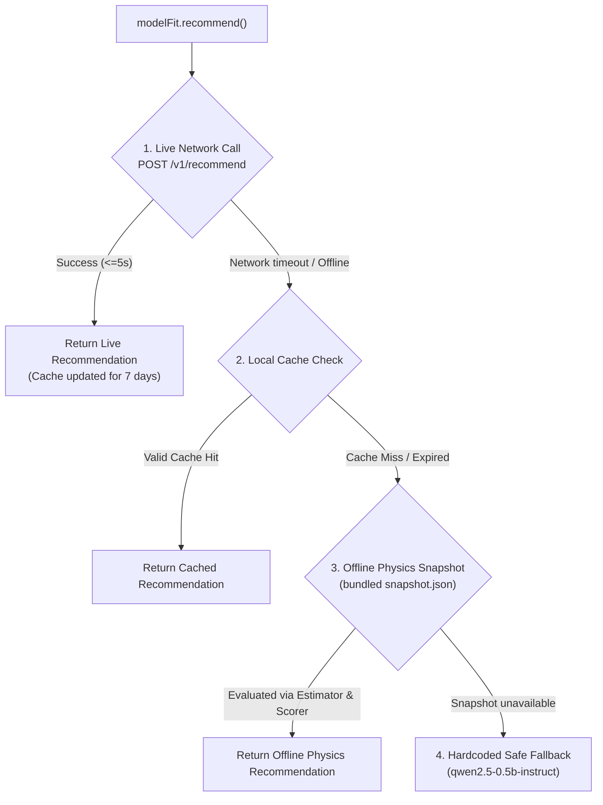

# ModelFit Android SDK

[](https://opensource.org/licenses/MIT)
[](https://developer.android.com)
[](https://github.com/QuantumPineapple68/ModelFit)

**ModelFit** is a lightweight, zero-overhead Android client SDK that delivers instant, zero-crash on-device Large Language Model (LLM) recommendations tailored to a device's physical hardware constraints and memory bus bandwidth.

---

## The Problem It Solves

- **Android Out-of-Memory (LMK) Kills**: Allocating an LLM weights tensor that exceeds free RAM triggers an uncatchable Linux kernel Low Memory Killer `SIGKILL`. The app crashes instantly.
- **Latency Collapse**: An oversized model on an underspecified mobile chip runs at 0.5–1.5 tokens/sec, taking minutes to answer and overheating the phone.
- **Extreme Fragmentation**: Over 25,000+ Android models exist. You cannot manually test every phone-model combination.

**ModelFit solves this using empirical physics scaling laws**:
$$\frac{1}{\text{Decode TPS}} = a + \frac{\text{Size (GB)}}{B}$$
By extracting the chip's usable DRAM memory bandwidth ($B$, in GB/s) and scheduling latency ($a$), ModelFit accurately predicts model speed (~83% accuracy) and guarantees that the recommended model runs safely within your user's physical RAM budget.

---

## Installation

### Step 1: Add the JitPack repository

In your root `settings.gradle.kts`:

```kotlin
dependencyResolutionManagement {
    repositoriesMode.set(RepositoriesMode.FAIL_ON_PROJECT_REPOS)
    repositories {
        google()
        mavenCentral()
        maven { url = uri("https://jitpack.io") }
    }
}
```

### Step 2: Add the dependency

In your app module's `build.gradle.kts`:

```kotlin
dependencies {
    implementation("com.github.QuantumPineapple68:ModelFit:Tag")
}
```

Or copy the pre-built `sdk-release.aar` (93 KB) directly into your app's `libs/` folder:

```kotlin
dependencies {
    implementation(files("libs/sdk-release.aar"))
}
```

---

## Quickstart

### 1. Initialize ModelFit

Initialize once in your `Application.onCreate()` or before requesting recommendations:

```kotlin
import dev.modelfit.ModelFit
import dev.modelfit.ModelFitConfig

val modelFit = ModelFit.create(
    context = applicationContext,
    config = ModelFitConfig(
        baseUrl = "https://benchdb.benchdb.workers.dev", // Edge backend (default)
        cacheTtlDays = 7,                                // Cache validity (7 days)
        timeoutMs = 5000                                 // 5s network timeout
    )
)
```

> **Zero-Effort Hardware Calibration**: On initialization, the SDK silently runs a 20ms DRAM memory-bandwidth micro-probe in the background once per install. It measures the phone's memory bus speed ($B$ in GB/s) and contributes it to the edge database with zero extra lines of code.

### 2. Request a Model Recommendation

```kotlin
import dev.modelfit.Profile
import dev.modelfit.Task

// In a coroutine / suspend function:
val recommendation = modelFit.recommend(
    profile = Profile.Balanced,  // Balanced | Speed | Quality | LowMemory | Custom
    task = Task.Chat             // Chat | Summarization | Code | Instruction
)

val bestModel = recommendation.items.firstOrNull()
if (bestModel != null) {
    println("Model: ${bestModel.modelId}")           // e.g. "llama-3.2-1b-instruct"
    println("Quantization: ${bestModel.quant}")      // e.g. "Q4_K_M"
    println("Expected Speed: ${bestModel.expected.decodeTps} tok/s")
    println("Expected RAM: ${bestModel.expected.peakRamMb} MB")
    println("Download URL: ${bestModel.download.url}")
    println("SHA-256: ${bestModel.download.sha256}")
    println("Decision Reasons: ${bestModel.reasons.joinToString("; ")}")
}
```

### 3. Automatically Profile & Keep Database Fresh (Active Learning)

When your app runs an inference, wrap it inside `measureInference`. The SDK automatically times the execution, measures RAM delta, and reports the metrics to the backend in the background to keep community calibrations fresh:

```kotlin
val reply = modelFit.measureInference(
    modelId = bestModel.modelId,
    quant = bestModel.quant,
    decodeTokens = 64,  // Number of tokens emitted
    promptTokens = 128  // Context length evaluated
) {
    // Your actual LLM execution code here:
    llamaEngine.generate("Tell me a joke")
}
```

Or report already-calculated metrics directly:

```kotlin
modelFit.reportMetrics(
    modelId = "llama-3.2-1b-instruct",
    quant = "Q4_K_M",
    decodeTps = 11.45,
    prefillTps = 25.10,
    peakRamMb = 848.0
)
```

---

## Profiles & Workload Tasks

### Available Profiles

| Profile | Focus | Constraints |
|---|---|---|
| `Profile.Balanced` | Best balance of speed & intelligence | Min 5 tok/s, max 30s latency, ≤ 50% RAM budget |
| `Profile.Speed` | Priority on speed | Min 8 tok/s, max 20s latency, ≤ 50% RAM budget |
| `Profile.Quality` | Priority on reasoning & model size | Min 3 tok/s, max 60s latency, ≤ 50% RAM budget |
| `Profile.LowMemory` | Priority on preserving system RAM | Min 5 tok/s, max 30s latency, ≤ 35% RAM budget |

### Custom Developer Profiles

Developers can specify exact latency limits and multi-objective weights:

```kotlin
val customProfile = Profile.Custom(
    weights = Weights(speed = 0.5f, quality = 0.3f, memory = 0.2f),
    minDecodeTps = 6f,          // Reject models below 6 tok/s
    maxTs = 25f,                // Reject models taking > 25s for reply
    ramBudgetFraction = 0.45f   // Reserve at most 45% of total system RAM
)

val recommendation = modelFit.recommend(profile = customProfile)
```

---

## 4-Tier Zero-Crash Fallback Hierarchy

ModelFit guarantees that calling `recommend()` **never crashes or throws network exceptions**:



1. **Live Network Call**: Queries Cloudflare edge for up-to-the-minute benchmarks and Hugging Face models.
2. **Local Cache Hit**: Returns instantly from `SharedPreferences` if probed within the 7-day TTL.
3. **Local Offline Snapshot Evaluation**: Runs the exact same physics bandwidth equations directly on-device using the bundled `snapshot.json`.
4. **Hardcoded Fallback**: Returns verified `qwen2.5-0.5b-instruct` (guaranteed safe for any Android phone with ≥ 2 GB RAM).

---

## Hardware Inspection API

Inspect physical hardware details programmatically:

```kotlin
val info = modelFit.probeDevice()

println("Chipset: ${info.socNormalized}") // e.g. "sm7435"
println("Total RAM: ${info.totalRamMb} MB")
println("Free RAM: ${info.availRamMb} MB")
println("CPU Cores: ${info.cpuCores}")
println("Manufacturer: ${info.manufacturer} ${info.model}")
```

---

## Architecture

```
dev.modelfit/
├── ModelFit.kt                       # Singleton facade & recommend() API
├── ModelFitConfig.kt                 # Configuration (Base URL, API Key, Cache TTL)
├── Profile.kt                        # Scoring profiles & utility weights
├── Task.kt                           # Predefined workloads (Chat, Summarization, Code)
├── Recommendation.kt                 # Recommendation data models & confidence tiers
├── device/
│   ├── DeviceProbe.kt                # Probes SoC, live available RAM, and CPU cores
│   └── SocNormalizer.kt              # SoC string cleaner & RAM tier mapping
├── net/
│   ├── ModelFitApi.kt                # Lightweight HTTP client
│   └── Dtos.kt                       # JSON serialization / deserialization
├── core/
│   ├── Estimator.kt                  # Physics memory bandwidth estimation
│   └── Scorer.kt                     # Constraint filtering & utility scoring
└── cache/
    ├── RecCache.kt                   # SharedPreferences cache with TTL
    └── SnapshotStore.kt              # Offline snapshot.json evaluator
```

---

## Privacy Policy

ModelFit collects **zero Personally Identifiable Information (PII)**:
- No user names, accounts, or email addresses.
- No Google Advertising IDs (GAID) or Android IDs.
- No MAC addresses, device serial numbers, or IP addresses stored.
- Only physical hardware attributes (SoC model, RAM capacity, CPU cores) are evaluated to ensure safe LLM execution.

---

## License

This project is licensed under the MIT License - see the [LICENSE](LICENSE) file for details.
